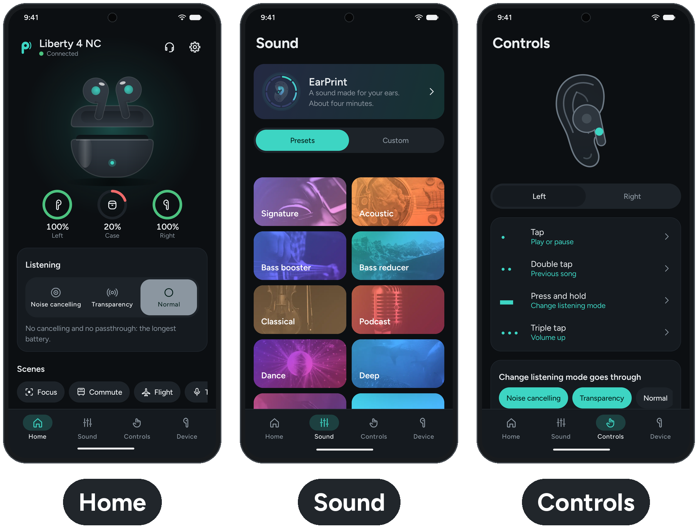

  

<h1 align="center">Blazbuds</h1>

  One app for your wireless earbuds, whatever brand they are. 
  No ads, no account, no waiting: open it and your earbuds are there.

  <a href="https://github.com/rajendra7169/blazbuds/releases/latest"><b>Download</b></a> · Android · Linux

  

## Features

- **Battery** for each earbud and the case, a low-battery alert at the level you choose, and a week of battery history
- **Listening modes**: noise cancelling with its strength, transparency with its level, and normal
- **Scenes**: Focus, Commute, Flight, Talk and Relax in one tap
- **Sound**: the earbuds' own presets, and your own sounds made with **+** and shared with a short code
- **EarPrint**: a hearing test that makes a sound shaped to your ears
- **Touch controls** drawn on an ear: pick a side and see what each touch does
- **Find my earbuds**, an **ear tip fit test**, **dual-connect**, gaming mode and each brand's own switches
- **Home-screen widget** and **quick-settings tile** on Android, and a **tray panel** on the computer
- **Light and dark looks**, updates inside the app, and a one-tap problem report

  

## Earbuds

| Brand | Models |
|---|---|
| Soundcore | Liberty 4 NC, and the Liberty, Life, Space, P, A, R, C, V and Sport series, Sleep A30 |
| Samsung | Galaxy Buds, Buds+, Live, Pro, Buds2, Buds2 Pro, Buds FE, Buds Core, Buds3, Buds3 FE, Buds3 Pro, Buds4, Buds4 Pro |
| Sony | WH-1000XM, WF-1000XM, LinkBuds, WF-C, WH-CH, WH-XB, WF-SP, WI-SP, WI-C, ULT WEAR |
| Nothing and CMF | Ear, Ear (a), Ear (1), (2), (3), (3a), Ear (open), Ear (stick), Headphone (1), CMF Buds and Headphone Pro |
| OnePlus, OPPO, realme | Buds, Nord Buds, Enco and realme Buds, about 140 models |
| Honor and Huawei | Honor Choice Earbuds X7e Active, Earbuds X, FreeBuds |
| Ultima and others | Ultima Boom Sleek and many earbuds on the JieLi chip |
| Anything else | Connection and battery |

Missing yours? Use **Help › Request your earbuds** in the app.

## Download

| | |
|---|---|
| Android 8 and later | The `.apk` from the [latest release](https://github.com/rajendra7169/blazbuds/releases/latest) |
| Linux | The `.deb` from the latest release, then `sudo apt install ./blazbuds_1.2.0_amd64.deb` |
| iPhone | Coming |

## Private

No ads, no account and no tracking. The app talks to your earbuds and goes online only to check for a new version, which you can turn off. Your settings stay on your device.

## Licence

GNU General Public License 3.0. See [LICENSE](LICENSE).

Blazbuds is not made by or connected with Anker, Soundcore, Honor, Huawei, Samsung, Sony, Nothing, OnePlus, OPPO, realme or Ultima.
