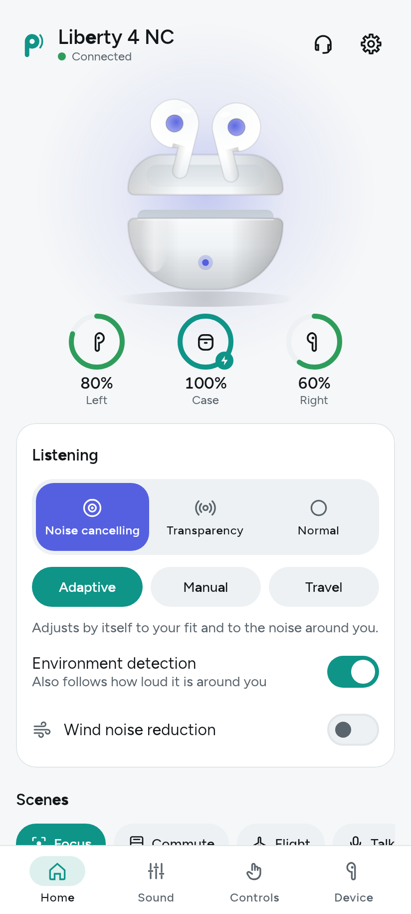
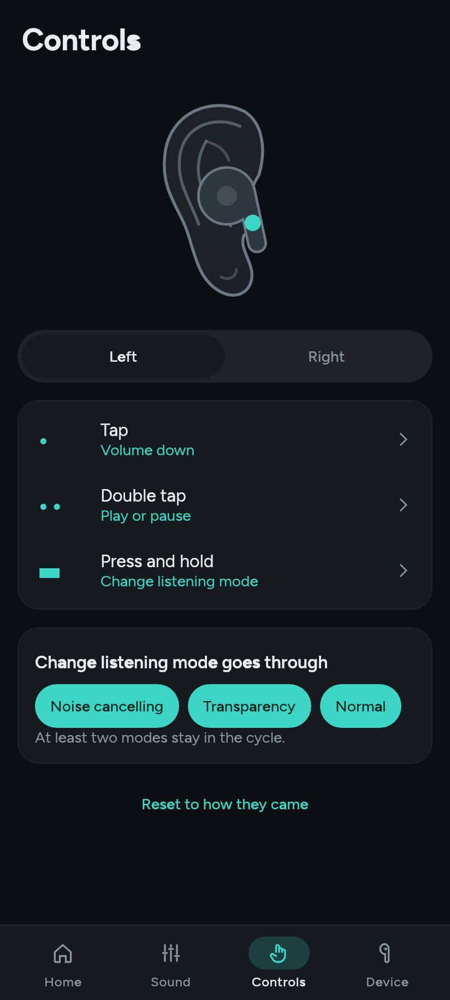
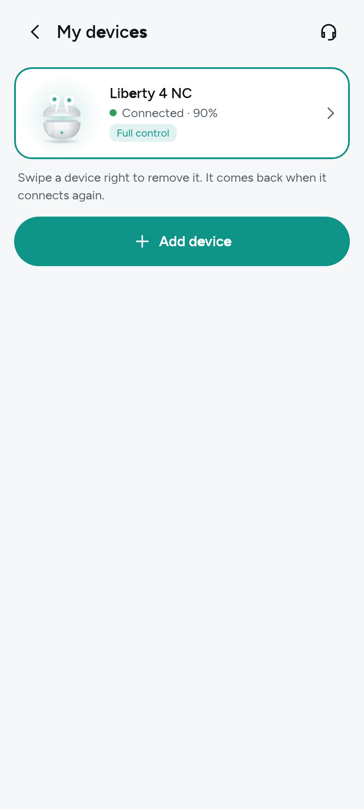
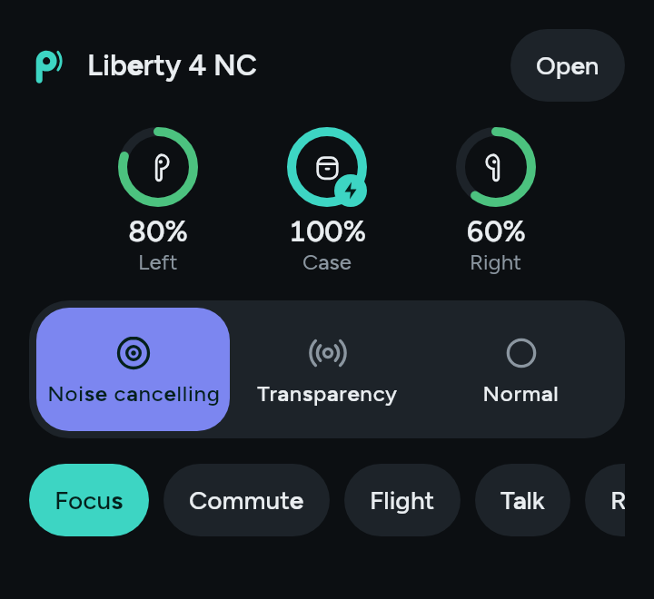
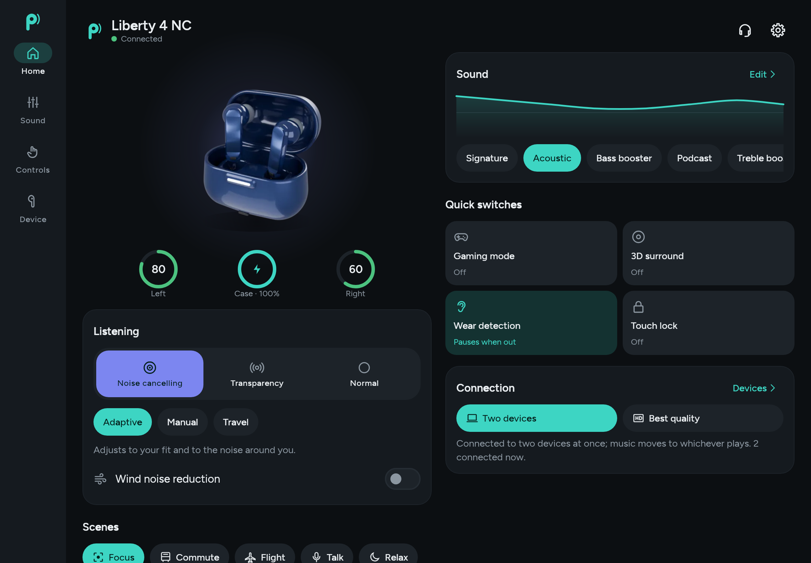

<p align="center">
  
</p>

<h1 align="center">Blazbuds</h1>

<p align="center">
  Control your wireless earbuds from any device.<br>
  No ads, no account, no waiting: open it and your earbuds are there.
</p>

---

## What it does

Everything you reach for is on one screen:

- **Battery** for each earbud and the case, updated as it changes
- **Listening mode**: noise cancelling (adaptive, manual strength, or tuned for plane, train, bus or car), transparency (everything, or voices only) and normal, with wind noise reduction
- **Scenes**: Focus, Commute, Flight, Talk and Relax put on the right mode with one tap
- **Sound**: Soundcore's 22 presets or your own curve over 8 bands, saved on the earbuds themselves so it plays the same on every device
- **Quick switches**: gaming mode, 3D surround, wear detection, touch lock
- **Two devices or best quality**: the Liberty 4 NC can join two devices at once or play LDAC to one; the app makes that choice plain and lists the devices the earbuds remember

- **Safe volume**: a cap on how loud they play, from 75 to 100 dB
- **Find my earbuds**, an **ear tip fit test**, and **how to wear them**, drawn on an ear

Touch controls are drawn on an ear too: pick a side, and each kind of touch (tap, double tap, triple tap, press and hold) shows what it does. Sound presets are colour tiles that show the shape of each sound. Tones and prompts, auto power off, and the earbuds' firmware and serial number are in the Device tab.

On Android, a home-screen widget shows the battery and switches modes, and a quick-settings tile changes the mode from the shade, both without opening the app.

On a computer it also lives in the tray: battery and mode in the menu, and a small panel on a click.

## Earbuds

| Earbuds | What works |
|---|---|
| Soundcore Liberty 4 NC | Everything above |
| Other Soundcore earbuds and headphones (Liberty, Life, Space, P, A, R, C, V and Sport series, Sleep A30) | Battery, listening modes, equalizer, touch controls and switches, as far as each model has them; not yet tried on the earbuds themselves |
| Honor Choice Earbuds X7e Active | Battery for each earbud and the case, sound presets (Default, Bass boost, Treble boost), double tap, triple tap and press-and-hold on each side, spatial surround, dynamic bass, gaming mode |
| Other Honor and Huawei earbuds (FreeBuds, Earbuds X) | Battery for each earbud and the case, listening modes where the pair has them, firmware; more as each model is tried |
| Ultima Boom Sleek and other Ultima earbuds | Battery for each earbud and the case, the earbuds' own sound presets and your own curve, double tap, triple tap and press-and-hold on each side, gaming mode |
| Other earbuds on the JieLi chip used by many lower-priced brands | Tried by themselves when an unknown pair connects; the same as Ultima when they answer |
| Samsung Galaxy Buds, Buds+, Live, Pro, Buds2, Buds2 Pro, Buds FE, Buds Core, Buds3, Buds3 FE, Buds3 Pro, Buds4 and Buds4 Pro | Battery, noise cancelling and ambient sound, how strongly it cancels (Pro, FE, Core, Buds3 FE and Buds3 Pro), sound presets and, from the Buds3 on, your own nine-band curve, voice detect on the Pro models, touch controls, touch lock, firmware; not yet tried on the earbuds themselves |
| Nothing Ear, Ear (a), Ear (1), (2), (3), (3a), Ear (open), Ear (stick), Headphone (1) and CMF Buds and Headphone Pro | Battery, listening modes, sound presets, touch controls, bass boost, wear detection, gaming mode; not yet tried on the earbuds themselves |
| OnePlus Buds, OPPO Enco and realme Buds that HeyMelody or realme Link control | Battery, listening modes, sound presets and your own curve, touch controls, ear tip fit test, 3D sound with head tracking, high-quality audio, vocal enhancement and other switches as each model has them; not yet tried on the earbuds themselves |
| Sony WH-1000XM, WF-1000XM, LinkBuds, WF-C, WH-CH, WH-XB, WF-SP, WI-SP, WI-C and ULT WEAR | Battery, noise cancelling and ambient sound, sound presets and your own curve, touch controls, speak-to-chat, sound upscaling, wear detection; not yet tried on the earbuds themselves |
| Any other Bluetooth earbuds | The basics: connection and battery, where the phone or computer can read it |

The app is built so each new brand plugs into the same screens.

## Devices

| | Status |
|---|---|
| Linux | Works |
| Android 8 and later | Works |
| iPhone | Being explored |
| Windows 10 and 11 | Built, not yet tried on a Windows computer |

## Small and private

The Android app is about 1.2 MB. It asks for one permission, Bluetooth, and has no internet access at all: it talks only to your earbuds. Settings stay on your device.

## Build it

You need JDK 21.

```sh
./gradlew :desktop:run               # the computer app (Linux or Windows)
./gradlew :desktop:run --args=--demo # try it without earbuds
./gradlew :android:assembleRelease   # the Android app
./gradlew :core:jvmTest              # the tests
```

`:desktop:packageDeb` and `:desktop:packageRpm` make Linux packages; on a Windows computer, `:desktop:packageMsi` and `:desktop:packageExe` make the Windows installers.

## Credits

The Soundcore protocol is understood thanks to the work of the [OpenSCQ30](https://github.com/Oppzippy/OpenSCQ30) and [Gadgetbridge](https://codeberg.org/Freeyourgadget/Gadgetbridge) projects. What each Soundcore model besides the Liberty 4 NC holds, and how to change it, is carried over from OpenSCQ30 (GPL-3.0), model by model. Text is set in [Figtree](https://github.com/erikdkennedy/figtree), under the SIL Open Font License.

Support for other brands builds on the work of these projects:

- **Samsung**: [GalaxyBudsClient](https://github.com/timschneeb/GalaxyBudsClient) by Tim Schneeberger (GPL-3.0), checked against Gadgetbridge, which also gives the Buds3 Pro's five cancelling strengths
- **Sony**: libmdr from [SonyHeadphonesClient](https://github.com/mos9527/SonyHeadphonesClient) (MIT, notice in [licenses/libmdr-MIT.txt](licenses/libmdr-MIT.txt)), with facts from Gadgetbridge
- **OnePlus, OPPO and realme**: [QuickBuds](https://github.com/spizganed/QuickBuds) by spizganed (GPL-3.0), its protocol notes and model list
- **Nothing and CMF**: the nada and nadamas projects (MIT), with facts from Gadgetbridge and ear (web)
- **Honor and Huawei**: protocol facts from [OpenFreebuds](https://github.com/melianmiko/OpenFreebuds) and Gadgetbridge; the Honor Choice settings were read from the earbuds themselves
- **JieLi chip earbuds**: the sign-in follows Jieli's own published SDK ([WeChat-Mini-Program-OTA](https://github.com/Jieli-Tech/WeChat-Mini-Program-OTA)) by way of [spacebuds-ctl](https://github.com/Desmond123-arch/spacebuds-ctl) (Apache-2.0)

Blazbuds is not made by or connected with Anker, Soundcore, Honor, Huawei, Samsung, Sony, Nothing, OnePlus, OPPO, realme or Ultima.

## Licence

GNU General Public License 3.0. See [LICENSE](LICENSE).

## Screenshots

<p>
  
  
  
</p>
<p>
  
  
  
</p>
<p>
  
</p>
