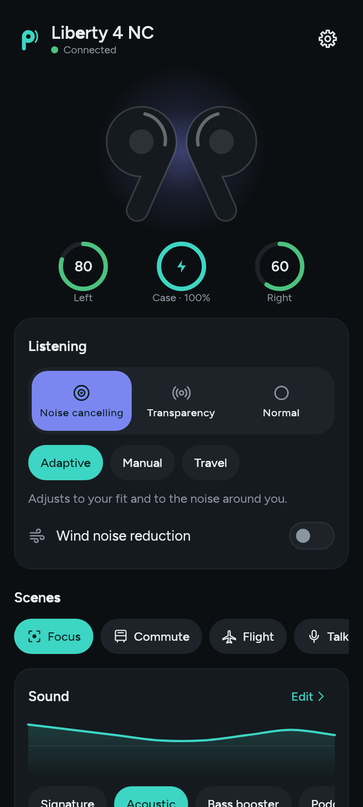
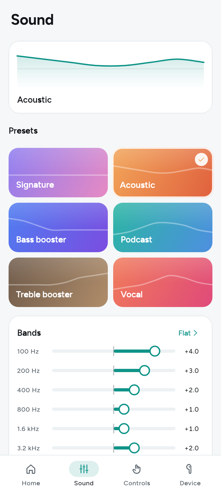
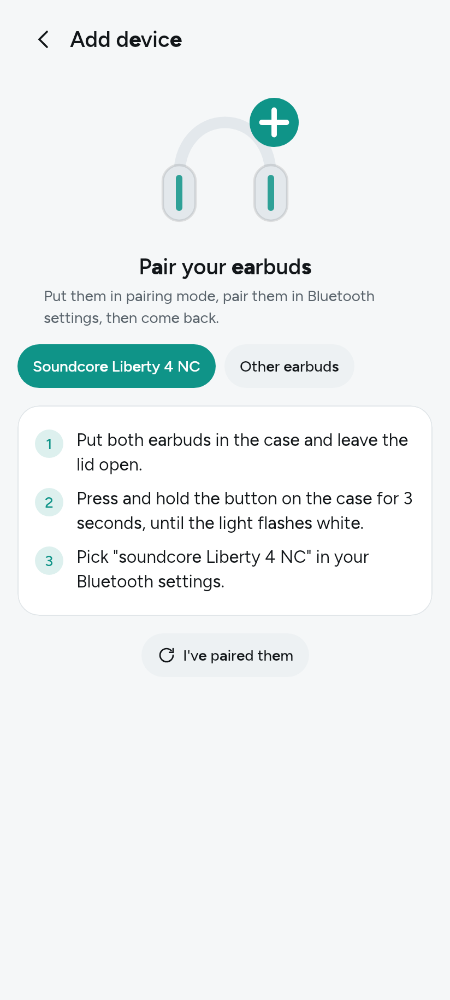
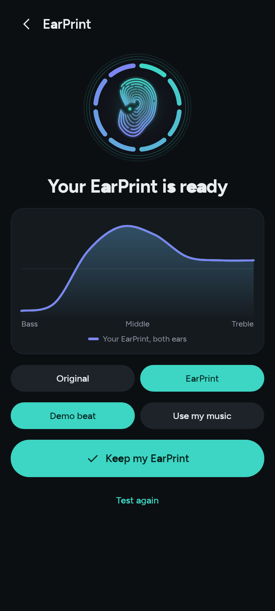
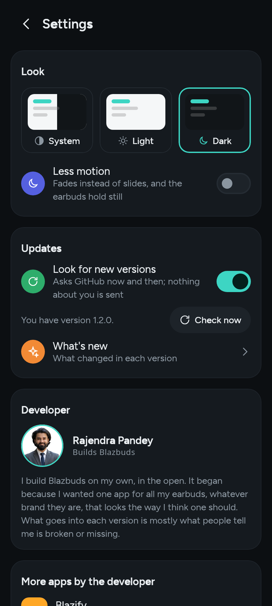
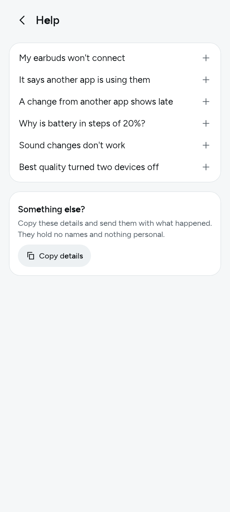

<p align="center">
  
</p>

<h1 align="center">Blazbuds</h1>

<p align="center">
  One app for your wireless earbuds, whatever brand they are.<br>
  No ads, no account, no waiting: open it and your earbuds are there.
</p>

<p align="center">
  <a href="https://github.com/rajendra7169/blazbuds/releases/latest"><b>Download the latest version</b></a>
  · Android · Linux
</p>

<p align="center">
  
  
  
</p>

---

## What it does

Everything you reach for is on one screen:

- **Battery** for each earbud and the case, a **low-battery alert** at the level you choose (10 to 40%), and a week of **battery history**
- **Listening mode**: noise cancelling (adaptive, a strength you pick, or tuned for travel), transparency with its level, and normal, as each pair has them
- **Scenes**: Focus, Commute, Flight, Talk and Relax put on the right mode with one tap
- **Sound**: the earbuds' own presets as picture tiles, and your own sounds made with **+**, saved on the earbuds and shared with a short code
- **EarPrint**: a hearing test and a listening test that make a sound shaped to your ears
- **Touch controls** drawn on an ear: pick a side, and each kind of touch shows what it does
- **Find my earbuds**: the earbuds ring themselves where they can, or play a sound through them
- **Ear tip fit test**, **dual-connect** with the devices your earbuds remember, safe volume, gaming mode and the rest of each brand's switches

On Android, a home-screen widget shows the battery and switches modes, and a quick-settings tile changes the mode from the shade. On a computer it lives in the tray, with a small panel a click away.

## Earbuds



| Brand | Models |
|---|---|
| Soundcore | Liberty 4 NC, and the Liberty, Life, Space, P, A, R, C, V and Sport series, Sleep A30 |
| Samsung | Galaxy Buds, Buds+, Live, Pro, Buds2, Buds2 Pro, Buds FE, Buds Core, Buds3, Buds3 FE, Buds3 Pro, Buds4, Buds4 Pro |
| Sony | WH-1000XM, WF-1000XM, LinkBuds, WF-C, WH-CH, WH-XB, WF-SP, WI-SP, WI-C, ULT WEAR |
| Nothing and CMF | Ear, Ear (a), Ear (1), (2), (3), (3a), Ear (open), Ear (stick), Headphone (1), CMF Buds and Headphone Pro |
| OnePlus, OPPO, realme | Buds, Nord Buds, Enco and realme Buds that HeyMelody or realme Link control, about 140 models |
| Honor and Huawei | Honor Choice Earbuds X7e Active, Earbuds X, FreeBuds |
| Ultima and JieLi | Ultima Boom Sleek and other Ultima pairs, and many lower-priced earbuds on the JieLi chip |
| Anything else | Connection and battery, where the phone or computer can read it |

Tried on real earbuds so far: the Soundcore Liberty 4 NC, the Honor Choice Earbuds X7e Active and the Ultima Boom Sleek. The rest follow each brand's protocol as the projects below document it. If yours misbehave or are missing, use **Help › Request your earbuds** in the app.

<br clear="right">

## Download

| | |
|---|---|
| Android 8 and later | The `.apk` from the [latest release](https://github.com/rajendra7169/blazbuds/releases/latest) |
| Linux (Debian, Ubuntu and others) | The `.deb` from the latest release, then `sudo apt install ./blazbuds_1.2.0_amd64.deb` |
| iPhone | Coming |

The app tells you when a new version is out (Settings › Updates), and **What's new** lists the changes.

## Small and private

No ads, no account and no tracking. The app talks to your earbuds, and goes online for one thing only: to ask GitHub whether a newer version is out, which you can switch off. Settings stay on your device.

When something goes wrong, **Help › Report a problem** copies what a report needs (the app, the system, the earbuds and what they said lately, nothing personal) and opens a filled-in report.

## More pictures

<p>
  
  
  
  
</p>
<p>
  
  
</p>

## Build it

You need JDK 21.

```sh
./gradlew :desktop:run               # the computer app
./gradlew :desktop:run --args=--demo # try it without earbuds
./gradlew :android:assembleRelease   # the Android app
./gradlew :core:jvmTest              # the tests
./gradlew :desktop:packageDeb        # a Linux package
```

## Credits

The Soundcore protocol is understood thanks to the work of the [OpenSCQ30](https://github.com/Oppzippy/OpenSCQ30) and [Gadgetbridge](https://codeberg.org/Freeyourgadget/Gadgetbridge) projects. What each Soundcore model besides the Liberty 4 NC holds, and how to change it, is carried over from OpenSCQ30 (GPL-3.0), model by model.

Support for other brands builds on the work of these projects:

- **Samsung**: [GalaxyBudsClient](https://github.com/timschneeb/GalaxyBudsClient) by Tim Schneeberger (GPL-3.0), checked against Gadgetbridge, which also gives the Buds3 Pro's five cancelling strengths
- **Sony**: libmdr from [SonyHeadphonesClient](https://github.com/mos9527/SonyHeadphonesClient) (MIT, notice in [licenses/libmdr-MIT.txt](licenses/libmdr-MIT.txt)), with facts from Gadgetbridge
- **OnePlus, OPPO and realme**: [QuickBuds](https://github.com/spizganed/QuickBuds) by spizganed (GPL-3.0), its protocol notes and model list
- **Nothing and CMF**: the nada and nadamas projects (MIT), with facts from Gadgetbridge and ear (web)
- **Honor and Huawei**: protocol facts from [OpenFreebuds](https://github.com/melianmiko/OpenFreebuds) and Gadgetbridge; the Honor Choice settings were read from the earbuds themselves
- **JieLi chip earbuds**: the sign-in follows Jieli's own published SDK ([WeChat-Mini-Program-OTA](https://github.com/Jieli-Tech/WeChat-Mini-Program-OTA)) by way of [spacebuds-ctl](https://github.com/Desmond123-arch/spacebuds-ctl) (Apache-2.0)

Text is set in [Figtree](https://github.com/erikdkennedy/figtree), under the SIL Open Font License. Preset pictures are listed in [docs/photo-credits.md](docs/photo-credits.md).

Blazbuds is not made by or connected with Anker, Soundcore, Honor, Huawei, Samsung, Sony, Nothing, OnePlus, OPPO, realme or Ultima.

## Licence

GNU General Public License 3.0. See [LICENSE](LICENSE).
