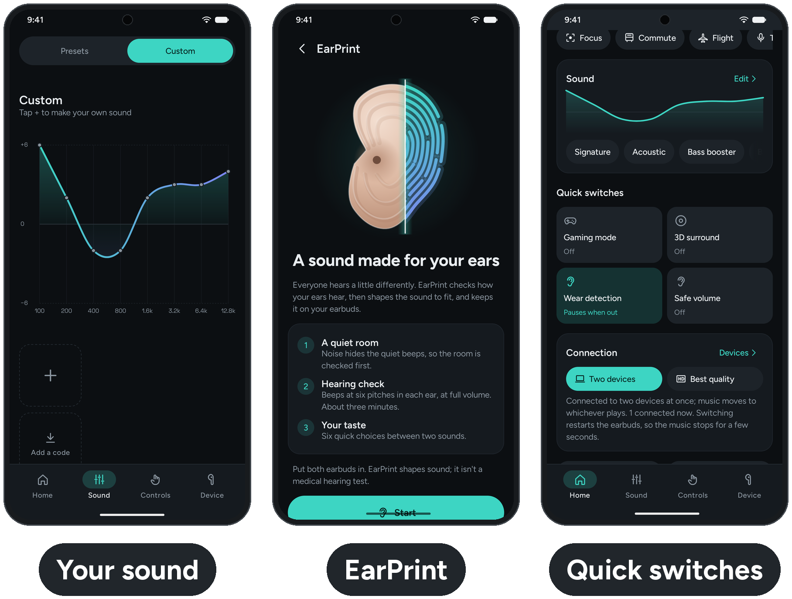
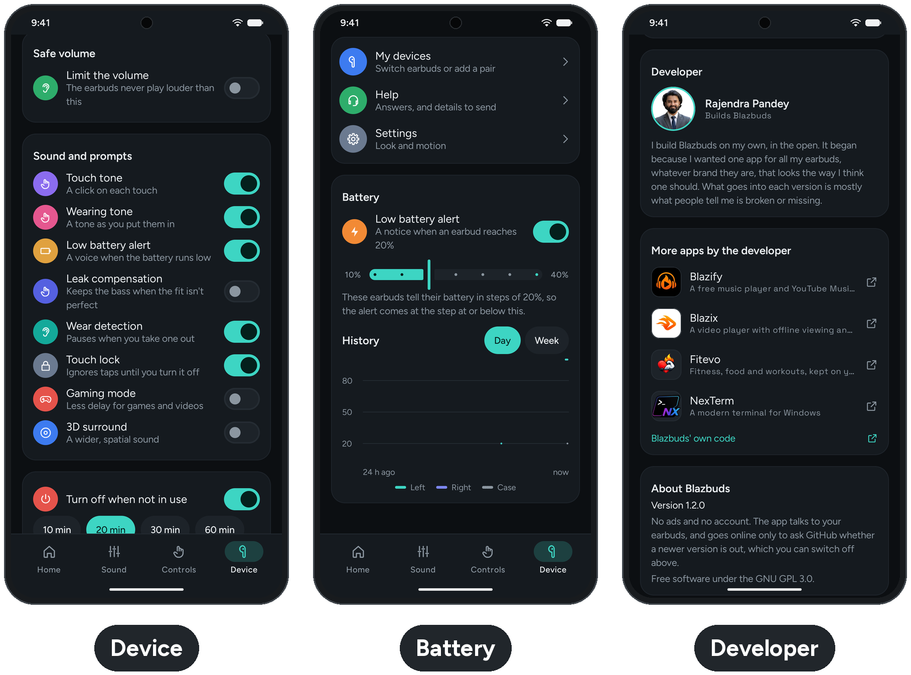
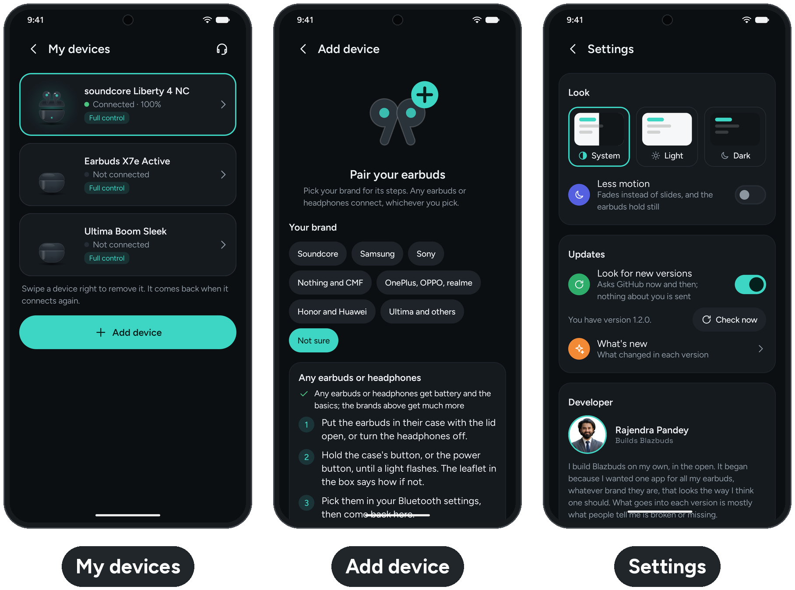

<p align="center">
  
</p>

<h1 align="center">Blazbuds</h1>

<p align="center">
  One app for your wireless earbuds, whatever brand they are.<br>
  No ads, no account, no waiting: open it and your earbuds are there.
</p>

<p align="center">
  <a href="https://github.com/rajendra7169/blazbuds/releases/latest"></a>
  <a href="https://github.com/rajendra7169/blazbuds/releases/latest"></a>
  
</p>

<p align="center">
  
</p>

## Features

<table>
<tr>
<td width="50%" valign="top"><b>Battery at a glance</b><br>Each earbud and the case, a low-battery alert at the level you pick (10 to 40%), and a week of battery history.</td>
<td width="50%" valign="top"><b>Listening modes</b><br>Noise cancelling with its strength, transparency with its level, and normal. Scenes set the right one in a tap: Focus, Commute, Flight, Talk, Relax.</td>
</tr>
<tr>
<td width="50%" valign="top"><b>Your sound</b><br>The earbuds' own presets as picture tiles, and your own curve made with <b>+</b>, saved on the earbuds and shared with a short code.</td>
<td width="50%" valign="top"><b>EarPrint</b><br>A hearing check and six quick choices between two sounds make a sound shaped to your ears, kept on your earbuds.</td>
</tr>
<tr>
<td width="50%" valign="top"><b>Touch controls</b><br>Drawn on an ear: pick a side and see what each tap, double tap, triple tap and press-and-hold does, then change it.</td>
<td width="50%" valign="top"><b>Find and fit</b><br>Earbuds that can ring themselves do; the rest play a sound through them. The ear tip fit test checks how well each one seals.</td>
</tr>
<tr>
<td width="50%" valign="top"><b>Connection</b><br>Two devices at once or the best sound quality, the devices your earbuds remember, and connect or forget each one.</td>
<td width="50%" valign="top"><b>Every switch</b><br>Gaming mode, 3D sound, wear detection, touch lock, safe volume, auto power off, tones and voice prompts, as each pair has them.</td>
</tr>
<tr>
<td width="50%" valign="top"><b>On your phone and computer</b><br>A home-screen widget and a quick-settings tile on Android; a tray panel on the computer. Light and dark looks.</td>
<td width="50%" valign="top"><b>Looked after</b><br>Updates inside the app, What's new, a one-tap problem report, and a form to ask for your earbuds.</td>
</tr>
</table>

<p align="center">
  
</p>
<p align="center">
  
</p>

## Earbuds

| Brand | Models |
|---|---|
| Soundcore | Liberty 4 NC, and the Liberty, Life, Space, P, A, R, C, V and Sport series, Sleep A30 |
| Samsung | Galaxy Buds, Buds+, Live, Pro, Buds2, Buds2 Pro, Buds FE, Buds Core, Buds3, Buds3 FE, Buds3 Pro, Buds4, Buds4 Pro |
| Sony | WH-1000XM, WF-1000XM, LinkBuds, WF-C, WH-CH, WH-XB, WF-SP, WI-SP, WI-C, ULT WEAR |
| Nothing and CMF | Ear, Ear (a), Ear (1), (2), (3), (3a), Ear (open), Ear (stick), Headphone (1), CMF Buds and Headphone Pro |
| OnePlus, OPPO, realme | Buds, Nord Buds, Enco and realme Buds, about 140 models |
| Honor and Huawei | Honor Choice Earbuds X7e Active, Earbuds X, FreeBuds |
| Ultima and others | Ultima Boom Sleek and many earbuds on the JieLi chip |
| Anything else | Connection and battery |

Missing yours? Use **Help › Request your earbuds** in the app.

<p align="center">
  
</p>

## Download

<p align="center">
  <a href="https://github.com/rajendra7169/blazbuds/releases/latest"></a>
  <a href="https://github.com/rajendra7169/blazbuds/releases/latest"></a>
  
</p>

On Linux, install the downloaded package with `sudo apt install ./blazbuds_1.3.0_amd64.deb`. Android needs version 8 or later. The app tells you when a new version is out.

## On a computer

While Blazbuds runs (the tray is enough), a terminal can ask it too:

```
blazbuds status            Liberty 4 NC  L 80%  R 80%  case 60%  Noise cancelling
blazbuds battery --json    the batteries as JSON
blazbuds mode transparency anc, transparency or normal
blazbuds scene focus       focus, commute, flight, talk or relax
```

On Linux the app adds the `blazbuds` command to `~/.local/bin` when that folder is on your PATH; otherwise use `/opt/blazbuds/bin/Blazbuds`.

**Home Assistant:** Settings › Home Assistant connects to your MQTT broker (the Mosquitto add-on works) and your earbuds appear by themselves as a device with their batteries, whether they're connected, and the listening mode and scenes to change from your dashboards and automations.

## Private

No ads, no account and no tracking. The app talks to your earbuds and goes online only to check for a new version, which you can turn off, to load Sounds by others when you open them, and to your own Home Assistant if you connect it. Your settings stay on your device.

## Licence

GNU General Public License 3.0. See [LICENSE](LICENSE).

Blazbuds is not made by or connected with Anker, Soundcore, Honor, Huawei, Samsung, Sony, Nothing, OnePlus, OPPO, realme or Ultima.
